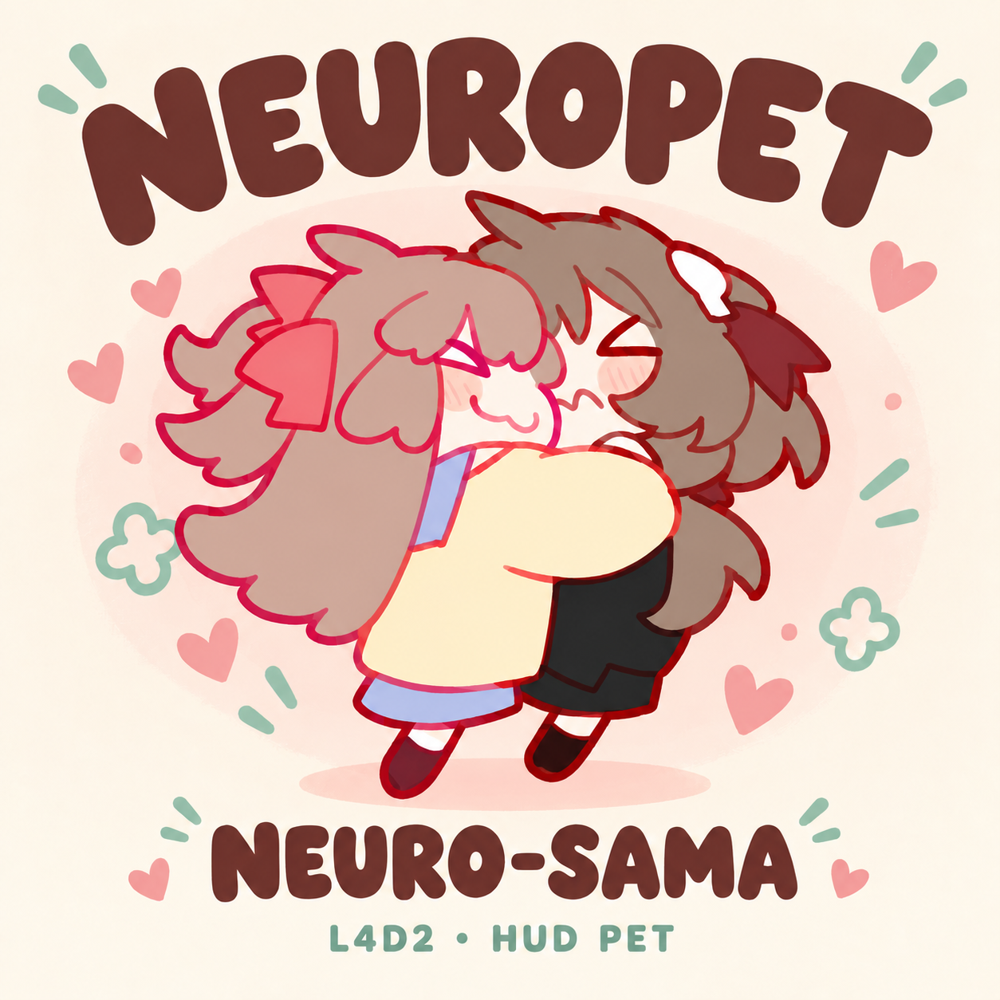
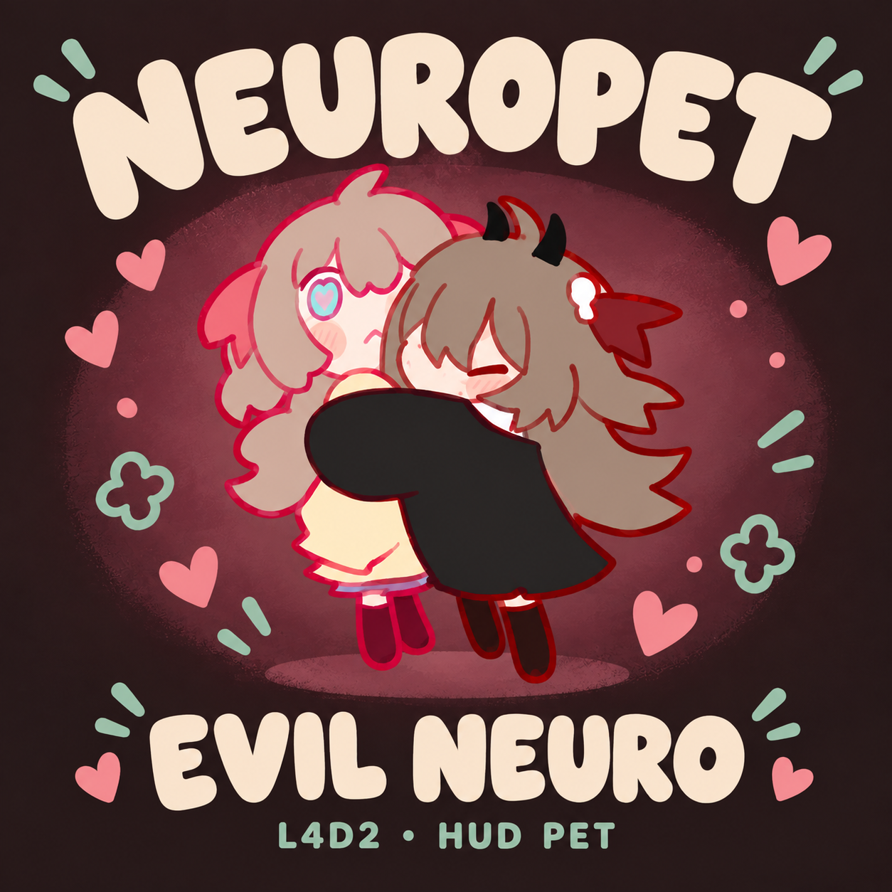

# L4D2 Neuropet

**English** | [简体中文](README.zh-CN.md)

A fan-made screen pet for Left 4 Dead 2. Between zombie fights, a tiny Neuro-sama or Evil Neuro hangs out around the edges of your screen: walking, climbing, resting, and now and then tripping over or stopping for a hug.

> **Unofficial fan project.** Not affiliated with or endorsed by Vedal. It only changes what's drawn on your HUD and doesn't affect gameplay. There is no AI, chat, voice or online feature; the pet only uses the characters' likeness.

| Neuro-sama | Evil Neuro |
| --- | --- |
|  |  |

Covers are AI-assisted compositions based on the original hug artwork, not gameplay screenshots. See [cover credits](assets/promotion/CREDITS.md).

## Download

There are two separate packages. **Pick one** and enable only one at a time.

> **HUD compatibility:** Compatibility with third-party HUD mods is not guaranteed. Addons that replace the same HUD layout may hide the pet or override parts of another HUD. The stock HUD is recommended. If the pet is missing, disable other HUD mods and restart the game. See [HUD conflicts and troubleshooting](docs/HUD_COMPATIBILITY.md).

| Character | Version | Steam Workshop | Release file | In-game addon name |
| --- | --- | --- | --- | --- |
| Neuro-sama | 0.5.2 | 【待填：工坊链接】 | `l4d2_neuropet_client.vpk` | Neuropet – Neuro-sama Screen Pet (Fan-made HUD Mascot) |
| Evil Neuro | 0.5.3 | 【待填：工坊链接】 | `l4d2_neuropet_evil_client.vpk` | Neuropet – Evil Neuro Screen Pet (Fan-made HUD Mascot) |

VPK files will be attached to GitHub Releases when the repository is published. They are not committed to the repository.

## What she does

- **Moves around:** walks, trots or slowly crawls along the bottom edge; climbs the left and right edges; moves along and hangs from the top; sometimes lets go and falls.
- **Rests in 8 ways:**

  | Neuro-sama | Evil Neuro |
  | --- | --- |
  | Standing blink | Standing blink |
  | Sitting blink | Sitting blink |
  | Lying down lazily | Lying down lazily |
  | Sitting, looking up | Sitting, looking up |
  | Wink | Waiting for a hug |
  | Heart hands | Shy (lying down) |
  | Shy (standing) | Shy (standing) |
  | Shy (sitting) | Shy (sitting) |

- **Little moments:** a trip-and-get-back-up animation, and a short hug animation in which her twin sister makes a guest appearance. The second character is part of the hug animation, not a second pet.
- **Not a fixed loop:** each stretch randomly picks a route, speed, rest time, target position, rest pose and little moment, and keeps them for that stretch. Bottom stopping points vary, and she continues from wherever she last stopped. Wall and top stops and drop positions also vary.

### Random weights

These are draw weights per stretch, not per-minute chances. Some actions can take a few minutes to show up.

| Draw | Options |
| --- | --- |
| Ground movement | Walk 60% · Trot 20% · Slow crawl 20% |
| Little moment | Trip 20% · Hug 20% · None 60% |

- **Trip** only happens while walking or trotting (never while crawling, climbing or resting). Base length is about 3.5 s: lose balance → down for about 1.5 s → push up → sit up → stand. With the stretch's speed factor it runs about 3–4.1 s.
- **Hug** can happen while moving on the ground or resting, at most once per eligible stretch. Base length is about 3.5 s; movement pauses during the hug, then continues.
- **Slow crawl** lasts longer over longer distances, so a small crawl pose never slides across the screen too quickly. The two crawl frames alternate at 3 fps.

### What she doesn't do

No dragging or clicking, no chat, voice or AI, no full Shimeji behavior system, no multi-pet interaction, no HUD avoidance and no real-time 2D collision physics.

She also **doesn't read or react to in-game events** (incaps, rescues, Tanks, Witches, hordes, safe rooms). Falls come from random animation segments. If she happens to drop right as a Tank shows up, that's just very good timing.

## Install

**Steam Workshop:** subscribe to one of the two items. To switch characters, unsubscribe from one, subscribe to the other, and restart the game.

**Manual:**

1. Put **one** VPK in `left4dead2/addons/` inside your game folder.
2. Enable it under **Add-ons** in the main menu and wait for it to finish loading.
3. Start a game as usual.

To switch characters, swap the VPK and restart. To uninstall, remove the VPK and restart. If you later subscribe to the same version on the Workshop, remove the manual copy so it isn't loaded twice.

It runs as a normal client-side addon on your own machine. The server doesn't need to install anything, and you don't need SourceMod, VSLib, Python, any external program, a browser, or any console command.

## Compatibility and known limitations

- **HUD mods:** compatibility with third-party HUD mods is not guaranteed. Both editions replace `scripts/hudlayout.res`; another addon supplying this file may hide the pet or override parts of either HUD. B4B Modified HUD & UI (3041458606) also supplies this file. Seeing both on one machine does not guarantee compatibility. Disable other HUD mods and restart if needed; see the [troubleshooting guide](docs/HUD_COMPATIBILITY.md).
- **She walks along the bottom edge.** No room is reserved for health bars; she may overlap your HUD or be partly hidden by it, depending on the HUD.
- **Servers:** some servers don't allow custom client addons. The design doesn't need anything installed on the server, but this hasn't been tested on remote servers yet.
- **Aspect ratio:** built for 16:9 by default. Other ratios can be rebuilt from source with a parameter, but haven't been verified.
- **Tested so far:** Windows, local co-op, 1280×720. Split-screen, infected view, Versus, Scavenge, other aspect ratios and remote servers are untested.
- **Performance:** no formal benchmarks yet, so we make no performance claims.
- **Certification:** not reviewed or certified by Valve.
- **Size:** each VPK is currently about 50.6 MiB, because the frame atlas is stored as uncompressed RGBA8888. This may change in future versions.

## How it works

Everything runs through the game's own HUD and material system:

- A client-side **VGUI ImagePanel** draws the pet.
- **VMT material proxies** compute time, random choices, animation frame and position inside the game.
- A **multi-frame VTF** holds the frame atlas.

Each package currently has 1 panel, a 202-frame atlas, 255 material proxies and 154 custom parameters. The runtime package contains no Squirrel/VScript, mutation, SourceMod plugin, DLL or external program.

**Python is used only at build time.** The builder reads the original animation frames, generates the atlas, compiles the material logic, reads the stock HUD layout template from *your own* L4D2 install, and writes the VPK.

### Build from source

Requirements:

- Python 3.10+ and Pillow
- A local Left 4 Dead 2 install (the builder reads the stock HUD template from it)

```
python -m pip install -r requirements.txt
python tools/build_client.py --character neuron --game-root "C:\Games\Left 4 Dead 2"
python tools/build_client.py --character evil --game-root "C:\Games\Left 4 Dead 2"
```

To build for another aspect ratio, set `--aspect`. Generated atlases, intermediate folders and VPKs are not committed; release builds are attached to Releases.

### What's in this repository

```text
assets/       mascot packs, covers and licenses
tools/        build, validation and packaging
docs/         behavior, tests and Workshop copy
research/     historical server-side VScript prototype
publication.json  titles, maintainer and accepted covers
```

- The builder
- Assets for both characters
- License files
- Documentation and a few validation records
- `research/`: an early server-side VScript prototype that explored a state machine, physics and game events. **It is not part of the current client addon and isn't shipped in any release.**

Not included: the full original references folder, copies of Valve game files, SDK binaries, private paths or experiment logs.

### Relation to web-mascot

This is **not** a port of [web-mascot](https://github.com/CommentOut64/web-mascot). Its TypeScript/DOM/XML engine was not ported. This project uses the separately licensed original artwork and animation frames as reference, and implements behavior and movement independently. It is not connected to the Neuro SDK.

### Evil Neuro 0.5.3 edge fix

Light outlines could appear around Evil Neuro's dark edges. The cause: fully transparent pixels in the original PNGs stored white RGB values, which texture filtering could blend into the edges. The fix extends nearby artwork colors into fully transparent pixels within four pixel steps. All alpha values and all visible RGBA pixels are unchanged.

All 202 frames were checked; size, anchors, visible details, materials and HUD layout are unchanged. In-game testing found the outline clearly reduced or no longer visible. We don't guarantee zero edge differences at every resolution or setup.

The before/after images in this repository are zoomed-in renders from a numerical sampling model, not in-game screenshots. The model's error reduction figures describe that model, not a percentage of visible improvement.

<details>
<summary><b>Testing notes</b></summary>

All tests: Windows, 1280×720, local co-op.

- **Neuro-sama 0.5.2:** a 75-second session plus a 120-second fixed slow-crawl demo. Crawl pacing confirmed comfortable.
- **Evil Neuro 0.5.3:** a 150-second session. Edge outline confirmed reduced.

In both, the game exited normally and no pet material errors were found.

During test setup we temporarily used in-game developer commands (for example to pause the AI Director and protect the test player), turned them off while observing the pet, and briefly turned them on at the end to query the server root table, which confirmed there is no server-side NeuroPet state machine. The addon itself doesn't need or provide any of these commands.

**Public source builds:** the behavior material previously passed 18,000 simulated bindings per edition. The final branded packages were rebuilt and CRC-checked. They add code/cover notices and an addon-list icon, and update the addon title/credits. The runtime atlas, behavior material and HUD layout are byte-for-byte identical to the validated versions; package hashes differ because the metadata changed. The branded package has not been separately playtested in full.

</details>

## A few words from us

We know, we know: L4D2 is a game where you really should be watching out for Hunters, not a little girl hanging off the top of your screen. We made it anyway, because she's just too cute.

We opened the source so that if you'd like to make your own pet, you don't have to start from zero. (The code is MIT; the artwork keeps its own license, see below.)

## License

This project uses two licenses:

- **Our own code:** [MIT](https://choosealicense.com/licenses/mit/). See [LICENSE](LICENSE).
- **Character artwork, animation/behavior configs, and their adaptations:** [CC BY-NC-SA 4.0](https://creativecommons.org/licenses/by-nc-sa/4.0/). See [NOTICE](NOTICE.md) and `assets/mascot_pack/`.

The MIT license does **not** cover the artwork. If you share or adapt the artwork or configs, you must keep the license and credits, note your changes, use them non-commercially only, and share under the same license.

The stock Valve HUD template is read from your own L4D2 install and is not relicensed under MIT. VSLib, SourceMod community work and the Source SDK 2013 were used only as references for how things work; none of them are included.

## Credits

- Character art: **Paccha** – https://linktr.ee/paccha_
- Original animation and behavior configs: **@promote.** (https://z.ne1.co, https://neuro.us.to) and **@dalekcraft**
- Original package and metadata: **qingchenyouforcc**
- Asset source: **CommentOut64/web-mascot** – https://github.com/CommentOut64/web-mascot
- Asset upstream: **NeurolingsCE-Qt** – https://github.com/qingchenyouforcc/NeurolingsCE-Qt

**Changes made for this project:** PNG converted to RGBA8888 VTF with transparent padding; mirrored for direction; frames re-sampled and re-timed; hug anchor normalized; trip pause and recovery added; crawl pacing and movement speed limits tuned; for Evil Neuro, colors extended into fully transparent pixels. The original PNG files are not modified.

Neuro-sama and Evil Neuro are AI VTubers; Evil Neuro is Neuro-sama's twin sister. Official site: https://vedal.ai/ · Stream: https://www.twitch.tv/vedal987. This project only uses the characters' likeness, claims no ownership of them, and is not affiliated with or endorsed by Vedal.

## Feedback and contributing

Bug reports and ideas are welcome: [GitHub Issues](https://github.com/Rbeyrolles/l4d2-neuropet/issues)

When contributing, code changes are accepted under MIT, and changes to artwork or configs must follow CC BY-NC-SA 4.0.

Maintained by Daisy, Shannon & Sol.
