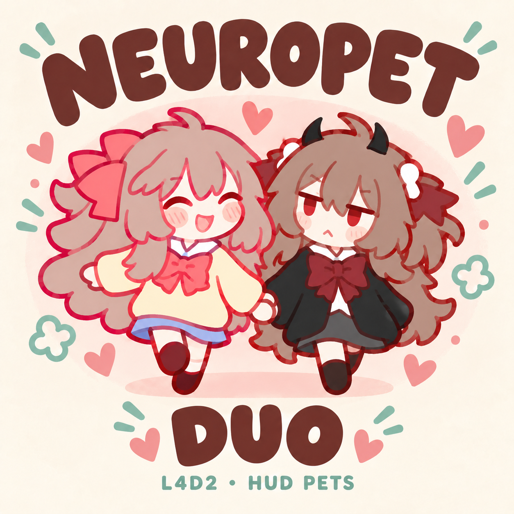

# L4D2 Neuropet

**English** | [简体中文](README.zh-CN.md)

A fan-made screen pet for Left 4 Dead 2. Between zombie fights, a tiny Neuro-sama, a tiny Evil Neuro, or both of them together hang out around the edges of your screen: walking, climbing, resting, and now and then tripping over or stopping for a hug.

Neuropet is one project with three packages to choose from: **Neuro-sama**, **Evil Neuro** and **Duo**. All three are maintained in this repository and built separately.

> **Unofficial fan project.** Not affiliated with or endorsed by Vedal. It only changes what's drawn on your HUD and doesn't affect gameplay. There is no AI, chat, voice or online feature; the pets only use the characters' likeness.

| Neuro-sama | Evil Neuro | Duo |
| --- | --- | --- |
|  |  |  |

All covers are AI-assisted promotional illustrations, not gameplay screenshots. The single-pet covers are based on the original hug artwork; the Duo cover is based on the character artwork and reference images. The hand-holding on the Duo cover is cover art only: in game, the two of them hug. See [cover credits](assets/promotion/CREDITS.md).

**See it in action:** [Duo Workshop page](https://steamcommunity.com/sharedfiles/filedetails/?id=3820220607). Positions and actions were staged for the demonstration at normal speed; the release picks them at random.

## Choose one

| | Neuro-sama | Evil Neuro | Duo |
| --- | --- | --- | --- |
| On screen | One Neuro-sama | One Evil Neuro | Both, roaming separately |
| The hug | Evil guest-stars inside the hug animation | Neuro guest-stars inside the hug animation | Either one walks or trots over to the other; they share the hug, then go their own ways |

**Pick one package and enable only that one.** For both pets on screen, choose Duo; there's no need to enable both single-pet packages. Each package has its own version numbers, so Duo 0.2.3 is not a downgrade from the single-pet 0.5.x.

## Download

> **HUD compatibility:** Compatibility with third-party custom HUD mods is not guaranteed. Addons that replace the same HUD layout may hide the pets or override parts of another HUD. The stock HUD is recommended. If the pets are missing, disable other HUD mods and restart the game. See [HUD conflicts and troubleshooting](docs/HUD_COMPATIBILITY.md).

| Package | Version | VPK file | Download | Steam Workshop | In-game addon name |
| --- | --- | --- | --- | --- | --- |
| Neuro-sama | 0.5.2 | `l4d2_neuropet_client.vpk` | https://github.com/Rbeyrolles/l4d2-neuropet/releases/download/client-2026-10-11/l4d2_neuropet_client.vpk | https://steamcommunity.com/sharedfiles/filedetails/?id=3820218016 | Neuropet – Neuro-sama Screen Pet (Fan-made HUD Mascot) |
| Evil Neuro | 0.5.3 | `l4d2_neuropet_evil_client.vpk` | https://github.com/Rbeyrolles/l4d2-neuropet/releases/download/client-2026-10-11/l4d2_neuropet_evil_client.vpk | https://steamcommunity.com/sharedfiles/filedetails/?id=3820220066 | Neuropet – Evil Neuro Screen Pet (Fan-made HUD Mascot) |
| Duo | 0.2.3 | `l4d2_neuropet_duo_interactive.vpk` | [Workshop](https://steamcommunity.com/sharedfiles/filedetails/?id=3820220607) | https://steamcommunity.com/sharedfiles/filedetails/?id=3820220607 | Neuropet – Neuro-sama & Evil Neuro Screen Pets (Fan-made HUD Mascots) |

Ready-made single-pet VPKs and SHA-256 checksums are available from [GitHub Releases](https://github.com/Rbeyrolles/l4d2-neuropet/releases). Duo is available through the Workshop or by building from source below. All three are built from this same repository; see [Build from source](#build-from-source) if you'd like to build them yourself. Players don't need Python or any build tools.

## What they do

### All three packages

- **Move around:** walk, trot or slowly crawl along the bottom edge; climb the left and right edges; move along and hang from the top; sometimes let go and fall; trip and get back up.
- **Rest in 8 ways:**

  | Neuro-sama | Evil Neuro |
  | --- | --- |
  | Standing blink | Standing blink |
  | Sitting blink | Sitting blink |
  | Lying down lazily | Lying down lazily |
  | Sitting, looking up | Sitting, looking up |
  | Wink | Waiting for a hug |
  | Heart hands | Shy (lying down) |
  | Shy (standing) | Shy (standing) |
  | Shy (sitting) | Shy (sitting) |

- **Not a fixed loop:** routes, speeds, rest times, stopping points and rest poses are chosen at random, and each pet continues from wherever she last stopped.

### Single-pet packages (Neuro-sama, Evil Neuro)

- **Little moments:** a trip-and-get-back-up animation, and a short hug animation in which her twin sister makes a guest appearance. In these packages the second character is part of the hug animation, not a second pet. For two pets, see Duo below.
- **Per stretch:** each stretch randomly picks a route, speed, rest time, target position, rest pose and little moment, and keeps them for that stretch. Wall and top stops and drop positions also vary.

#### Random weights (single-pet packages only)

These are draw weights per stretch, not per-minute chances. Some actions can take a few minutes to show up. They don't apply to Duo.

| Draw | Options |
| --- | --- |
| Ground movement | Walk 60% · Trot 20% · Slow crawl 20% |
| Little moment | Trip 20% · Hug 20% · None 60% |

- **Trip** only happens while walking or trotting (never while crawling, climbing or resting). Base length is about 3.5 s: lose balance → down for about 1.5 s → push up → sit up → stand. With the stretch's speed factor it runs about 3–4.1 s.
- **Hug** can happen while moving on the ground or resting, at most once per eligible stretch. Base length is about 3.5 s; movement pauses during the hug, then continues.
- **Slow crawl** lasts longer over longer distances, so a small crawl pose never slides across the screen too quickly. The two crawl frames alternate at 3 fps.

### Duo

- **Two pets, each on her own.** Neuro-sama and Evil Neuro pick their own routes and stopping points. They can explore different parts of the screen edges; they don't split it in half.
- **Chance meetings:** when both are on the bottom edge and close together, they may stop for a hug.
- **Going to find her:** when they're farther apart, one may set off to find the other, walking if she's close or trotting if she's far, approaching from either side. Either of them can start it, regardless of who's on the left.
- **The hug** uses the original artwork that already shows both characters. It lasts about four seconds; while it plays the two pets become one shared picture, then they separate and carry on. There's no third pet.
- **Patience:** after a hug there's at least about 45 seconds before the next one can happen, and positions and chance decide the rest, so there's no fixed schedule.

Implementation, tests and limits: [Interactive Duo](docs/duo-interactions.md).

### What none of them do

No dragging or clicking, no chat, voice or AI, no full Shimeji behavior system, no HUD avoidance and no real-time 2D collision physics. In Duo, interactions only happen on the bottom edge: there's no wall or ceiling hugging, no general collision avoidance and no hand-holding or following.

They also **don't read or react to in-game events** (incaps, rescues, Tanks, Witches, hordes, safe rooms). Falls come from random animation segments. If one drops right as a Tank shows up, that's just very good timing.

## Install

**Steam Workshop:** subscribe to **one** Neuropet item and start the game. The pets appear on the HUD after you load into a map; the main menu has none. Steam updates subscribed items automatically; restart the game after an update.

**Manual:**

1. Put **one** Neuropet VPK in `left4dead2/addons/` inside your game folder.
2. Enable it under **Add-ons** in the main menu.
3. Restart the game and load into a map as usual.

**Upgrade (manual):** replace the old VPK with the new one of the same name, then restart.
**Switch:** unsubscribe from or remove the current package, subscribe to or add the other one, then restart. Keep only one Neuropet package enabled.
**Uninstall:** unsubscribe, or delete the VPK from `addons/`, then restart.

Don't keep a manual copy and a Workshop subscription of the same package at the same time.

Every package runs as a normal client-only addon on your own machine. The server doesn't need to install anything, and you don't need SourceMod, VSLib, Python, any external program, a browser, or any console command. Python is only needed to build from source.

## Compatibility and known limitations

- **HUD mods:** compatibility with third-party custom HUD mods is not guaranteed. All three packages replace `scripts/hudlayout.res`; another addon supplying this file may hide the pets or override parts of either HUD. Other third-party custom HUD mods may also supply this file. Neuropet doesn't scan, merge or reorder other HUDs, and seeing both on one machine does not guarantee compatibility. Disable other HUD mods and restart if needed; see the [troubleshooting guide](docs/HUD_COMPATIBILITY.md).
- **Screen edges:** no room is reserved for health bars, so the pets may overlap your HUD or be partly hidden by it along the bottom. On the sides and top, part of a pet can go past the screen edge, as if holding on.
- **Servers:** some servers don't allow custom client addons, and nothing here can get around that. The design doesn't need anything installed on the server, but it hasn't been tested on remote servers yet.
- **Aspect ratio:** built for 16:9 by default. The single-pet packages can be rebuilt for other ratios from source with a parameter, but this hasn't been verified, and Duo has not been checked at other ratios.
- **Tested so far:** Windows, local co-op, 1280×720 for all three packages; the Duo promotional video was also recorded in game at 1920×1080. Split-screen, infected view, Versus, Scavenge, other aspect ratios and remote servers are untested.
- **Duo sync:** short frame drops, different draw rates and recovery after a hug have been checked. A long pause in drawing just one of the pets, missing the whole start of an interaction, or reloading only one of the two materials can still break sync. If the two look out of sync, fully restart the game.
- **Performance:** no formal benchmarks yet, so we make no performance claims. Duo does more material calculation than a single pet.
- **Certification:** not reviewed or certified by Valve.
- **Size:** each single-pet VPK is currently about 50.6 MiB, because the frame atlas is stored as uncompressed RGBA8888; the Duo VPK is about 115.7 MiB. This may change in future versions.

## How it works

Everything runs through the game's own HUD and material system:

- Client-side **VGUI ImagePanels** draw the pets.
- **VMT material proxies** compute time, random choices, animation frame and position inside the game.
- **Multi-frame VTFs** hold the frame atlases.

| | Single-pet packages | Duo |
| --- | --- | --- |
| Panels | 1 | 2 (one per character) |
| Atlas frames | 202 | 231 per character: the original 202, 1 blank frame and 28 mirrored hug frames |
| Material proxies | 255 | 254 per material |
| Custom parameters | 154 | 106 per material |

In Duo, each of the two materials computes the shared state of both pets and draws its own character, so they agree on where everyone is and when to hug. No runtime package contains Squirrel/VScript, mutations, SourceMod plugins, DLLs or external programs.

**Python is used only at build time.** The builders read the original animation frames, generate the atlases, compile the material logic, read the stock HUD layout template from *your own* L4D2 install, and write the VPKs.

### Build from source

Requirements: Python 3.10+, Pillow, and a local Left 4 Dead 2 install (the builder reads the stock HUD template from it).

```powershell
python -m pip install -r requirements.txt

# Single-pet packages. Build both before building Duo.
python -B tools/build_client.py --character neuron --game-root "C:\Games\Left 4 Dead 2"
python -B tools/build_client.py --character evil --game-root "C:\Games\Left 4 Dead 2"

# Duo, built from the two single-pet packages and their manifests above.
python -B tools/build_duo_interactive.py
python -B tools/check_duo_interactive.py
```

Replace the example path with your own game folder. Outputs go to `dist/`. Full steps, checks and options are in [docs/BUILDING.md](docs/BUILDING.md). Generated atlases, intermediate folders and VPKs are not committed; release builds are attached to Releases.

### One repository, three build targets

All three packages live on the same main branch. "Package" or "edition" here means a choice of what to install, not a separate Git branch. Duo reuses the character assets, texture processing, build and validation tools and license files, and adds its own interaction logic and build entry point.

| Package | Build entry | Publication config |
| --- | --- | --- |
| Neuro-sama | `tools/build_client.py --character neuron` | `publication.json` |
| Evil Neuro | `tools/build_client.py --character evil` | `publication.json` |
| Duo | `tools/build_duo_interactive.py` (needs both single-pet builds) | `publication-duo.json` |

### What's in this repository

```text
assets/mascot_pack/     shared Neuron / Eviling artwork and their original licenses
assets/promotion/       covers and how they were made (Duo cover in duo/)
tools/                  builders, Duo behavior compiler, validation and packaging
docs/                   behavior, building, Duo notes, tests and Workshop copy
research/               historical server-side VScript prototype
publication.json        single-pet titles, descriptions, credits and covers
publication-duo.json    the same for Duo
```

- `tools/build_client.py`: builds the two single-pet packages.
- `tools/build_duo_interactive.py`: builds Duo from the two single-pet packages.
- `tools/duo_pair_graph.py`, `tools/duo_perimeter_behavior.py`: Duo's material-proxy compiler and its movement and interaction logic.
- `tools/check_duo_interactive.py`: Duo behavior checks.
- License files, documentation and a few validation records.
- `research/`: an early server-side VScript prototype that explored a state machine, physics and game events. **It is not part of any of the three client packages and isn't shipped in any release.**

Not included: generated VPKs and VTFs, full raw gameplay recordings, the original references folder, copies of Valve game files, SDK binaries, personal experiment folders, private paths or configs.

### Relation to web-mascot

This is **not** a port of [web-mascot](https://github.com/CommentOut64/web-mascot). Its TypeScript/DOM/XML engine was not ported. This project uses the separately licensed original artwork and animation frames as reference, and implements behavior and movement independently. It is not connected to the Neuro SDK.

### Evil Neuro 0.5.3 edge fix

Light outlines could appear around Evil Neuro's dark edges. The cause: fully transparent pixels in the original PNGs stored white RGB values, which texture filtering could blend into the edges. The fix extends nearby artwork colors into fully transparent pixels within four pixel steps. All alpha values and all visible RGBA pixels are unchanged. Duo uses the same corrected frames.

All 202 frames were checked; size, anchors, visible details, materials and HUD layout are unchanged. In-game testing found the outline clearly reduced or no longer visible. We don't guarantee zero edge differences at every resolution or setup.

The before/after images in this repository are zoomed-in renders from a numerical sampling model, not in-game screenshots. The model's error reduction figures describe that model, not a percentage of visible improvement.

<details>
<summary><b>Testing notes</b></summary>

All tests: Windows, 1280×720, local co-op.

- **Neuro-sama 0.5.2:** a 75-second session plus a 120-second fixed slow-crawl demo. Crawl pacing confirmed comfortable.
- **Evil Neuro 0.5.3:** a 150-second session. Edge outline confirmed reduced.
- **Duo 0.2.2-preview behavior (shipped unchanged in 0.2.3):** five directed interaction scenes plus a minute of ordinary random movement, recorded continuously for about 121 seconds. The tester saw normal walking, hugs and recovery, with no flicker or mismatch. Directed starting positions were used to check actions and don't reflect the release's interaction frequency. Simulated checks covered 18,000 bindings per material, missed frames, 15 FPS vs 60 FPS drawing and a receiver paused while hidden. Details: [Interactive Duo](docs/duo-interactions.md).

In all of them, the game exited normally and no pet material errors were found.

During single-pet test setup we temporarily used in-game developer commands (for example to pause the AI Director and protect the test player), turned them off while observing the pet, and briefly turned them on at the end to query the server root table, which confirmed there is no server-side NeuroPet state machine. The addon itself doesn't need or provide any of these commands.

**Public source builds:** the single-pet behavior material previously passed 18,000 simulated bindings per edition. The final branded packages were rebuilt and CRC-checked. They add code/cover notices and an addon-list icon, and update the addon title/credits. The runtime atlas, behavior material and HUD layout are byte-for-byte identical to the validated versions; package hashes differ because the metadata changed. The branded package has not been separately playtested in full. Likewise, Duo 0.2.3 only changes metadata, the addon icon and cover credits compared with the tested 0.2.2-preview.

</details>

## A few words from us

We know, we know: L4D2 is a game where you really should be watching out for Hunters, not a little girl hanging off the top of your screen. We made it anyway, because she's just too cute. Then her sister wanted in too, so now there are two.

We share the source so that if you'd like to make your own pet, you don't have to start from zero. (The code is MIT; the artwork keeps its own license, see below.)

## License

This project uses two licenses:

- **Our own code:** [MIT](https://choosealicense.com/licenses/mit/). See [LICENSE](LICENSE).
- **Character artwork, animation/behavior configs, and their adaptations** (including Duo's mirrored hug frames): [CC BY-NC-SA 4.0](https://creativecommons.org/licenses/by-nc-sa/4.0/). See [NOTICE](NOTICE.md) and `assets/mascot_pack/`.

The MIT license does **not** cover the artwork. If you share or adapt the artwork or configs, you must keep the license and credits, note your changes, use them non-commercially only, and share under the same license.

The stock Valve HUD template is read from your own L4D2 install and is not relicensed under MIT. VSLib, SourceMod community work and the Source SDK 2013 were used only as references for how things work; none of them are included.

## Credits

- Project: **Daisy, Shannon & Sol**
- Character art: **Paccha** – https://linktr.ee/paccha_
- Original animation and behavior configs: **@promote.** (https://z.ne1.co, https://neuro.us.to) and **@dalekcraft**
- Original package and metadata: **qingchenyouforcc**
- Asset source: **CommentOut64/web-mascot** – https://github.com/CommentOut64/web-mascot
- Asset upstream: **NeurolingsCE-Qt** – https://github.com/qingchenyouforcc/NeurolingsCE-Qt

**Changes made for this project:** PNG converted to RGBA8888 VTF with transparent padding; mirrored for direction; frames re-sampled and re-timed; hug anchor normalized; trip pause and recovery added; crawl pacing and movement speed limits tuned; for Evil Neuro, colors extended into fully transparent pixels. Duo adds a fully transparent frame and pixel-mirrored copies of the original hug frames to each atlas. The original PNG files are not modified.

The covers and the Duo video's end card are AI-assisted illustrations based on the character artwork and reference images. They are not original high-resolution artwork by Paccha.

Neuro-sama and Evil Neuro are AI VTubers created by Vedal; Evil Neuro is Neuro-sama's twin sister. Official site: https://vedal.ai/ · Stream: https://www.twitch.tv/vedal987. This project only uses the characters' likeness, claims no ownership of them, and is not connected to their AI or stream systems or affiliated with or endorsed by Vedal.

## Feedback and contributing

Bug reports and ideas are welcome: [GitHub Issues](https://github.com/Rbeyrolles/l4d2-neuropet/issues). Please mention which package and version you use.

When contributing, code changes are accepted under MIT, and changes to artwork or configs must follow CC BY-NC-SA 4.0.

Maintained by Daisy, Shannon & Sol.
